# Unified app redesign — private candidate visual atlas

**All23 app sources, the Pomodoro reference correction and the copy-only package composition passed independent review and are integrated locally. Not pushed, published, merged, flashed or physically qualified.** See [current verified status](app-redesign-status.md); immutable capture-time receipts retain their original preparation status. Source review is carried only for exact frozen bytes. Both proposed catalogs are validation-only: their existing repository/ref fields still point to old served bytes, not these local candidate packages. No new download URL is live.

The 23 target IDs correspond to the supplied PDF pages. The source catalog stays at37 (19 targets); the owner-store catalog stays at41 (23 targets). All18 non-target records and files retain their respective canonical baseline bytes; no unrelated preview repair is carried. Versions are taken from the once-advanced manifests, without another increment. Only six parent-accepted presentation fields change beyond version/files: Dice, Rosary and Daily Office names, and Water/Stopwatch/Hourglass descriptions, exactly as recorded in accepted-metadata.json. All other metadata, capabilities and minimum API remain canonical. Pomodoro now displays actual ceiling remaining minutes with MIN LEFT, matching the reference's large 25 / MIN LEFT rather than the superseded mistaken mm:ss direction. Exact second accounting is unchanged; automatic timer repaint requests are minute-bounded.

All46 current frames are actual native SDL renderer outputs from **extracted single-app SD packages**, using the existing pinned full simulator and genuine runtime fonts/art. No test-font UI, drawing reconstruction or static-reference background was used. Native476×796 /796×476 are actual two-pixel-bezel crops of logical480×800 /800×480, not padded/resized screenshots. Contact sheets alone scale existing pixels for comparison. The bitmap Numeric Sans module/metrics/eight cuts/OFL/source notice form an exact12-member dependency where used; it does not change the host binary.

Every native run started inside `unshare -n`, with a denied-connect control, native networking opt-out before app initialization, software GL and dummy audio. Weather, Browser, Hacker News and Trivia are **TRUE OFFLINE**, with no populated response fixtures, providers, fetched news/headlines/images, NYT sites, credentials or private user data. Values, cases, words, cards and clocks are genuine dynamic application state, not forced PDF samples. Timer capture wrappers only translate the signed host monotonic origin. Launch wrappers set orientation (Desk Stand after its saved-style initialization); they are not installed package members.

The previous41-app gallery and provenance are preserved separately, unchanged. Only23 README thumbnails are proposed replacements; the other18 images remain explicitly historical and are **not** newly captured canonical app code.

## Qualification boundary

- Safe ZIP/readback/exact hashes and copy-only sentinel overlays passed for all23 packages and combined overlay.
- Current production catalog parser, safe ID/path predicates, dynamic file lists and installed-root selection were exercised with real existing ArduinoJson and local filesystem/downloader adapters. Both37/41 catalogs and PSRAM/non-PSRAM admission were tested; successful-path upgrades preserve canonical/legacy sentinels. Six omitted-asset/stale-version/unrelated-record negative controls were rejected.
-46 current full-native frames reconcile exactly23 IDs ×2 orientations; no Lua/native error logs or blank/wrong-dimension frames are accepted. Retained failed/superseded attempts remain labelled in the provenance.
- These tests do not establish physical touch recognition, e-ink, SD/FAT durability, radio/provider operation, exhaustive game completion, sleep/wake, or new native firmware compilation. Typography is the approved app-local/native-font fit, not a pixel-identical PDF claim. Real Codex artwork is preserved instead of the reference's schematic placeholder. Paginated text can continue beyond the displayed page; this atlas is not exhaustive state coverage.

## Install this candidate safely (manual copy-overlay only)

These are app-only SD packages for a compatible Crosscub Sticky Lua host, not firmware images. Do not flash anything for this payload. Preserve the hidden directory name and full nested file tree.

1. Shut down/eject the device safely and **back up the complete SD card**, including hidden `.crosssmudge`, legacy `.smudge`, books, settings and saves. Verify that the backup is readable before changing the card.
2. Use an SD-card reader. Extract `crosscub-unified-23-apps-candidate-sd-copy-overlay.zip` to the SD root, or select the versioned single-app SD ZIP. The resulting path is `/.crosssmudge/applications/<id>/manifest.json` with the complete matching Lua/font/art/license tree.
3. **Merge/copy and replace only archive member files.** Keep existing nonmembers and saves. Do not delete/replace the whole app folder, use a mirror/`--delete` operation, format the card, uninstall an app, or upload the combined overlay to an unqualified web ZIP installer. If the file manager offers only whole-directory replacement, cancel and use a copy-only tool.
4. Verify the copied member hashes against the package manifest, safely eject, reinsert and launch. Keep the backup until your own save/reopen and portrait/landscape checks pass. Canonical `.crosssmudge/applications/<id>` takes precedence over legacy `.smudge/applications/<id>`; retain both roots and do not delete legacy saves to troubleshoot precedence.

**Do not use App Store Update for this candidate yet.** Nothing here has been published, and the current actual native `installApp` removes an existing destination before downloading its replacement and writes members in place. A locally injected download failure reproduced a missing old runtime member; successful-path tests preserved nonmember saves, but do not prove transactional updates. Cancellation/failure may leave a mixed or incomplete app, and Uninstall removes directories. No native installer repair is included. The current bytes did not demonstrate whole-folder save deletion during ordinary Update; the precise reproduced failure is per-member pre-removal. Final integration/installation review remains required.

## Per-app current capture / package metadata

### Flashcards (`flashcards`) — 0.1.2

PDF page 1; minimum API 2; 8 runtime members. fresh startup, real app state.

[Portrait](images/apps-redesigned/flashcards.png) · [Landscape](images/apps-redesigned/landscape/flashcards.png) · Package `flashcards-0.1.2-sd.zip`

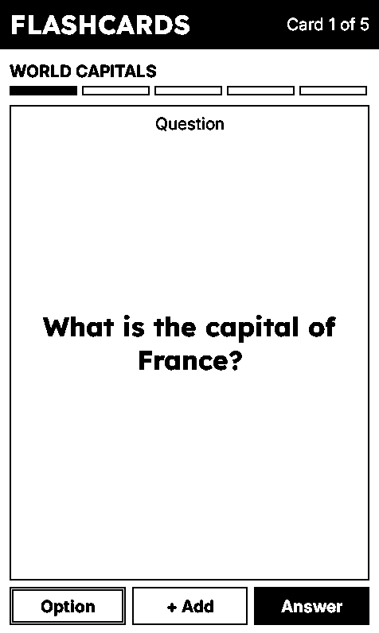

### Habits (`habits`) — 0.1.2

PDF page 2; minimum API 2; 8 runtime members. fresh startup, real app state.

[Portrait](images/apps-redesigned/habits.png) · [Landscape](images/apps-redesigned/landscape/habits.png) · Package `habits-0.1.2-sd.zip`

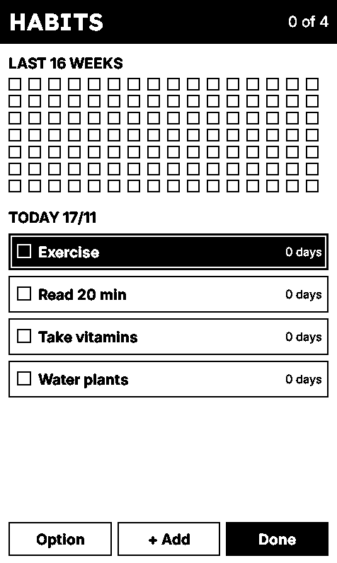

### Pomodoro (`pomodoro`) — 0.1.1

PDF page 3; minimum API 2; 21 runtime members. fresh startup, real app state.

[Portrait](images/apps-redesigned/pomodoro.png) · [Landscape](images/apps-redesigned/landscape/pomodoro.png) · Package `pomodoro-0.1.1-sd.zip`

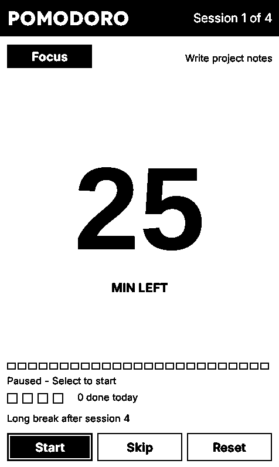

### Weather (`weather`) — 0.1.1

PDF page 4; minimum API 3; 11 runtime members. TRUE OFFLINE; no provider data, no response fixture.

[Portrait](images/apps-redesigned/weather.png) · [Landscape](images/apps-redesigned/landscape/weather.png) · Package `weather-0.1.1-sd.zip`

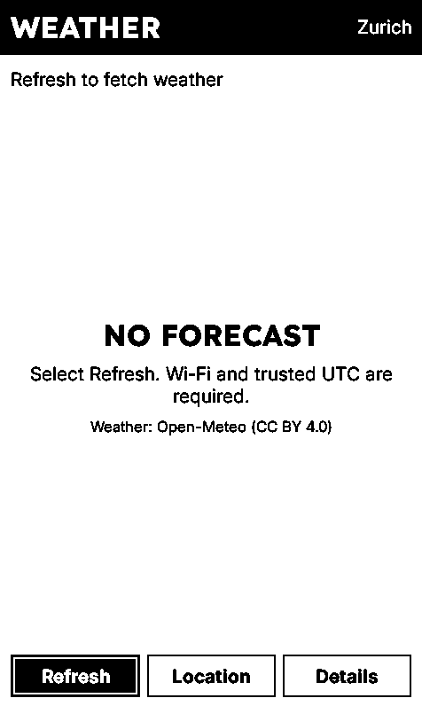

### Browser (`browser`) — 0.3.3

PDF page 5; minimum API 6; 19 runtime members. TRUE OFFLINE; no provider data, no response fixture.

[Portrait](images/apps-redesigned/browser.png) · [Landscape](images/apps-redesigned/landscape/browser.png) · Package `browser-0.3.3-sd.zip`

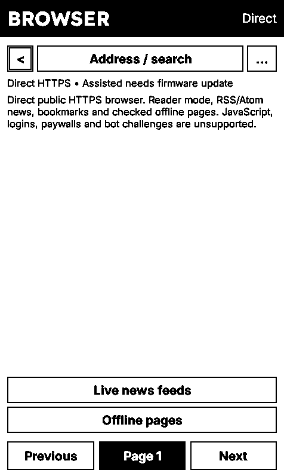

### Dice (`dice`) — 1.0.2

PDF page 6; minimum API inherited host default; 10 runtime members. D6 selected through real footer input; default unchanged.

[Portrait](images/apps-redesigned/dice.png) · [Landscape](images/apps-redesigned/landscape/dice.png) · Package `dice-1.0.2-sd.zip`

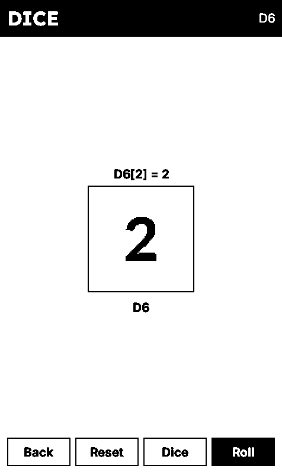

### Life Counter (`lifecounter`) — 1.0.2

PDF page 7; minimum API inherited host default; 7 runtime members. fresh startup, real app state.

[Portrait](images/apps-redesigned/lifecounter.png) · [Landscape](images/apps-redesigned/landscape/lifecounter.png) · Package `lifecounter-1.0.2-sd.zip`

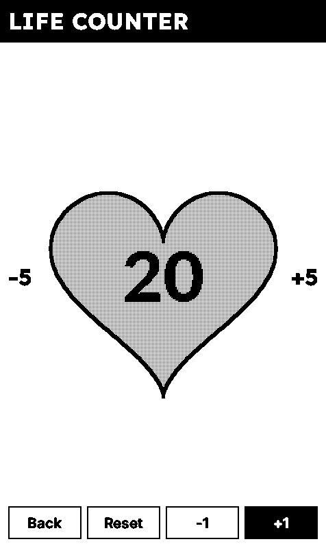

### Rosary (`rosary`) — 1.0.2

PDF page 8; minimum API inherited host default; 5 runtime members. fresh startup, real app state.

[Portrait](images/apps-redesigned/rosary.png) · [Landscape](images/apps-redesigned/landscape/rosary.png) · Package `rosary-1.0.2-sd.zip`

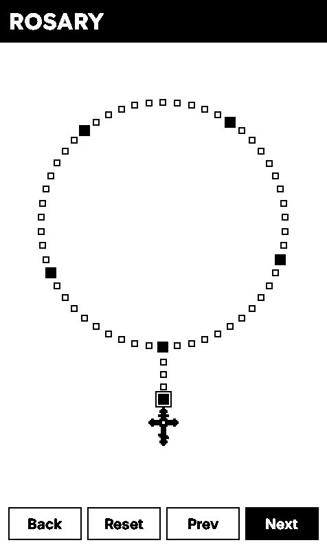

### Daily Office (`dailyoffice`) — 1.0.2

PDF page 9; minimum API inherited host default; 17 runtime members. fresh startup, real app state.

[Portrait](images/apps-redesigned/dailyoffice.png) · [Landscape](images/apps-redesigned/landscape/dailyoffice.png) · Package `dailyoffice-1.0.2-sd.zip`

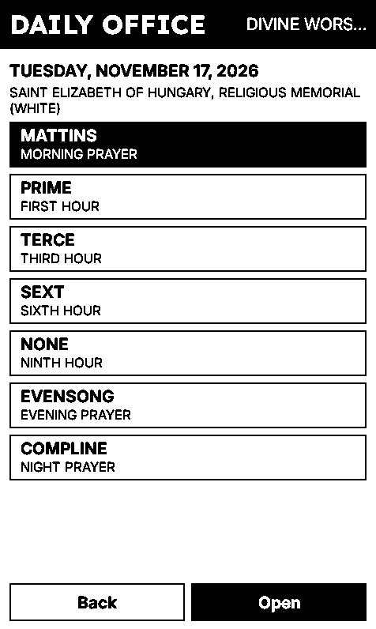

### 2048 (`2048`) — 1.1.1

PDF page 10; minimum API inherited host default; 9 runtime members. fresh startup, real app state.

[Portrait](images/apps-redesigned/2048.png) · [Landscape](images/apps-redesigned/landscape/2048.png) · Package `2048-1.1.1-sd.zip`

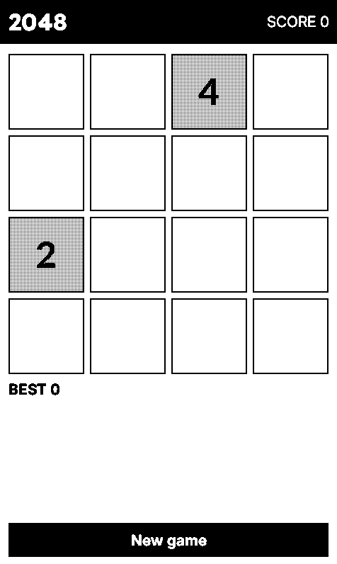

### Blackjack (`blackjack`) — 1.0.2

PDF page 11; minimum API inherited host default; 8 runtime members. gameplay after real Confirm; actual random cards/content.

[Portrait](images/apps-redesigned/blackjack.png) · [Landscape](images/apps-redesigned/landscape/blackjack.png) · Package `blackjack-1.0.2-sd.zip`

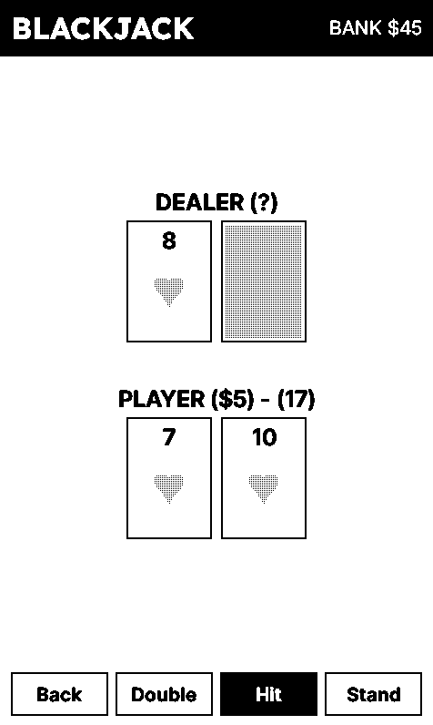

### Block Drop (`blockdrop`) — 1.0.3

PDF page 12; minimum API inherited host default; 4 runtime members. fresh startup, real app state.

[Portrait](images/apps-redesigned/blockdrop.png) · [Landscape](images/apps-redesigned/landscape/blockdrop.png) · Package `blockdrop-1.0.3-sd.zip`

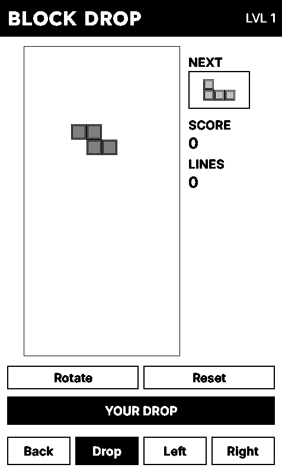

### Codex: Ink & Iron (`codex`) — 1.0.2

PDF page 13; minimum API inherited host default; 59 runtime members. gameplay after real Confirm; actual random cards/content.

[Portrait](images/apps-redesigned/codex.png) · [Landscape](images/apps-redesigned/landscape/codex.png) · Package `codex-1.0.2-sd.zip`

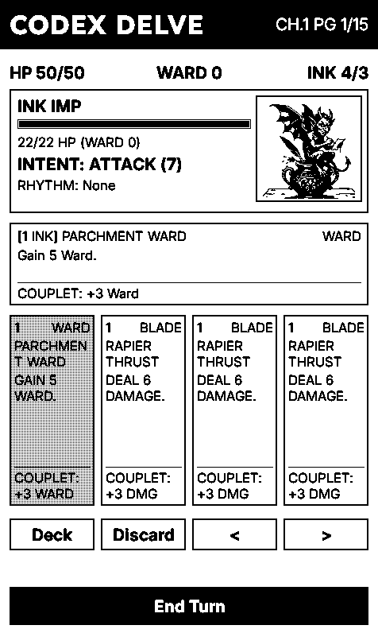

### Water Tracker (`watertracker`) — 1.0.3

PDF page 14; minimum API inherited host default; 18 runtime members. fresh startup, real app state.

[Portrait](images/apps-redesigned/watertracker.png) · [Landscape](images/apps-redesigned/landscape/watertracker.png) · Package `watertracker-1.0.3-sd.zip`

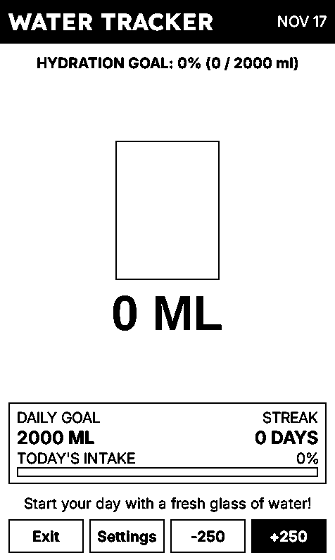

### Stopwatch (`stopwatch`) — 1.0.3

PDF page 15; minimum API inherited host default; 17 runtime members. running real relative host monotonic timer with real Split input.

[Portrait](images/apps-redesigned/stopwatch.png) · [Landscape](images/apps-redesigned/landscape/stopwatch.png) · Package `stopwatch-1.0.3-sd.zip`

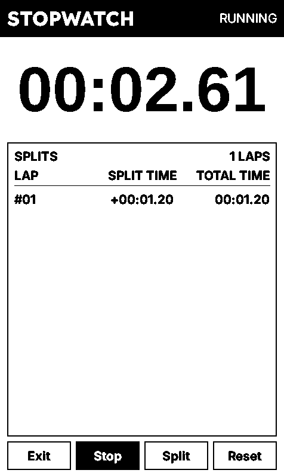

### Desk Stand (`dashboard`) — 1.0.4

PDF page 16; minimum API inherited host default; 17 runtime members. fresh startup, real app state.

[Portrait](images/apps-redesigned/dashboard.png) · [Landscape](images/apps-redesigned/landscape/dashboard.png) · Package `dashboard-1.0.4-sd.zip`

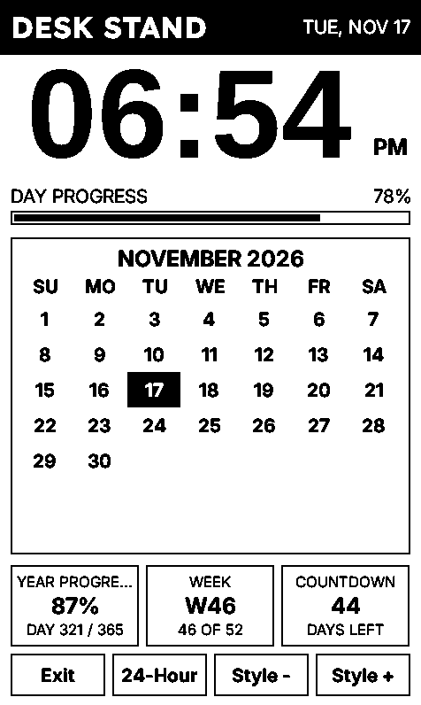

### Hourglass (`hourglass`) — 1.0.3

PDF page 17; minimum API inherited host default; 18 runtime members. running real relative host monotonic timer.

[Portrait](images/apps-redesigned/hourglass.png) · [Landscape](images/apps-redesigned/landscape/hourglass.png) · Package `hourglass-1.0.3-sd.zip`

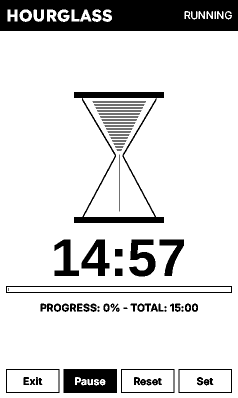

### Wavelength (`cp-wavelength`) — 0.1.5

PDF page 18; minimum API 2; 40 runtime members. practice pass-device privacy phase after real Play input.

[Portrait](images/apps-redesigned/cp-wavelength.png) · [Landscape](images/apps-redesigned/landscape/cp-wavelength.png) · Package `cp-wavelength-0.1.5-sd.zip`

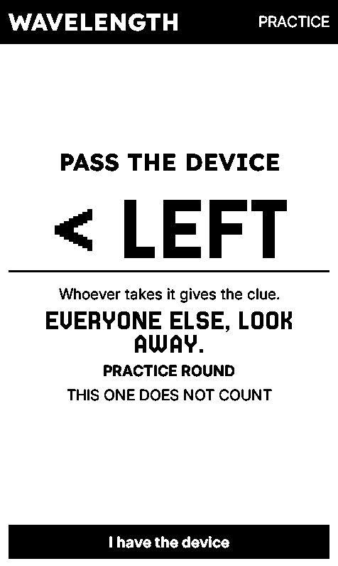

### Forehead (`cp-forehead`) — 0.1.5

PDF page 19; minimum API 2; 122 runtime members. active real word after Play and Start inputs.

[Portrait](images/apps-redesigned/cp-forehead.png) · [Landscape](images/apps-redesigned/landscape/cp-forehead.png) · Package `cp-forehead-0.1.5-sd.zip`

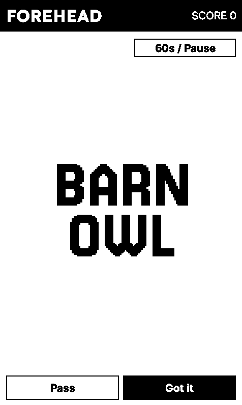

### Hearts (`cp-hearts`) — 0.1.5

PDF page 20; minimum API 2; 46 runtime members. passing selection phase after real start input.

[Portrait](images/apps-redesigned/cp-hearts.png) · [Landscape](images/apps-redesigned/landscape/cp-hearts.png) · Package `cp-hearts-0.1.5-sd.zip`

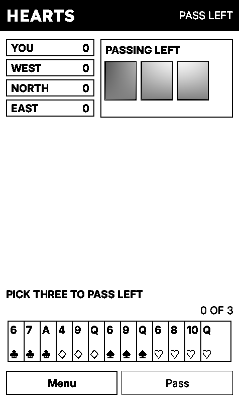

### Murdle (`cp-murdle`) — 0.1.5

PDF page 21; minimum API 2; 96 runtime members. actual generated case clues after real Play input; no forced sample case.

[Portrait](images/apps-redesigned/cp-murdle.png) · [Landscape](images/apps-redesigned/landscape/cp-murdle.png) · Package `cp-murdle-0.1.5-sd.zip`

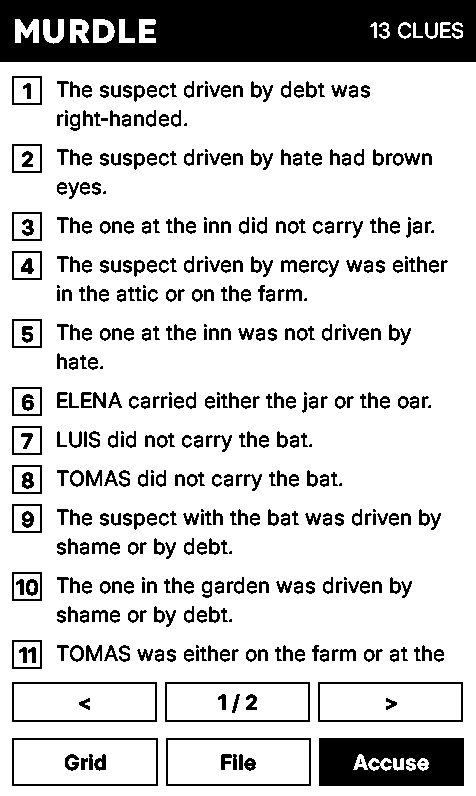

### Hacker News (`cp-hackernews`) — 0.1.4

PDF page 22; minimum API 3; 33 runtime members. TRUE OFFLINE; no provider data, no response fixture.

[Portrait](images/apps-redesigned/cp-hackernews.png) · [Landscape](images/apps-redesigned/landscape/cp-hackernews.png) · Package `cp-hackernews-0.1.4-sd.zip`

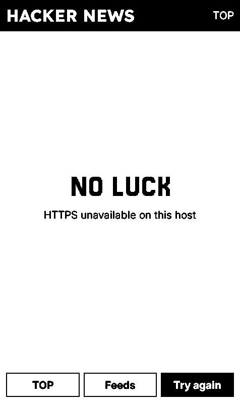

### Trivia (`cp-trivia`) — 0.1.4

PDF page 23; minimum API 3; 23 runtime members. TRUE OFFLINE; no provider data, no response fixture.

[Portrait](images/apps-redesigned/cp-trivia.png) · [Landscape](images/apps-redesigned/landscape/cp-trivia.png) · Package `cp-trivia-0.1.4-sd.zip`

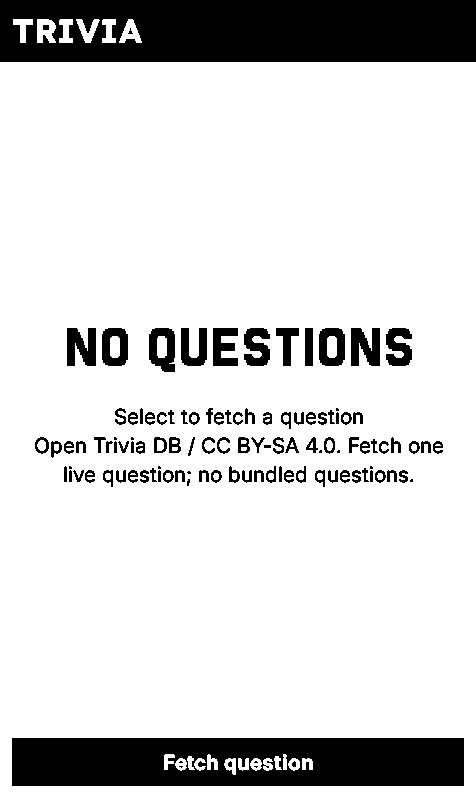

## Local provenance

The separately delivered package/capture/artifact manifests and SOURCE-FREEZE identify every runtime leaf, archive, renderer binary, wrapper, real input schedule, log and PNG hash. The downloadable-delivery ZIPs are local artifacts pending parent approval; repository-relative documentation links become available only after an authorized integration. See [interactive two-orientation atlas](app-redesign-atlas.html).
